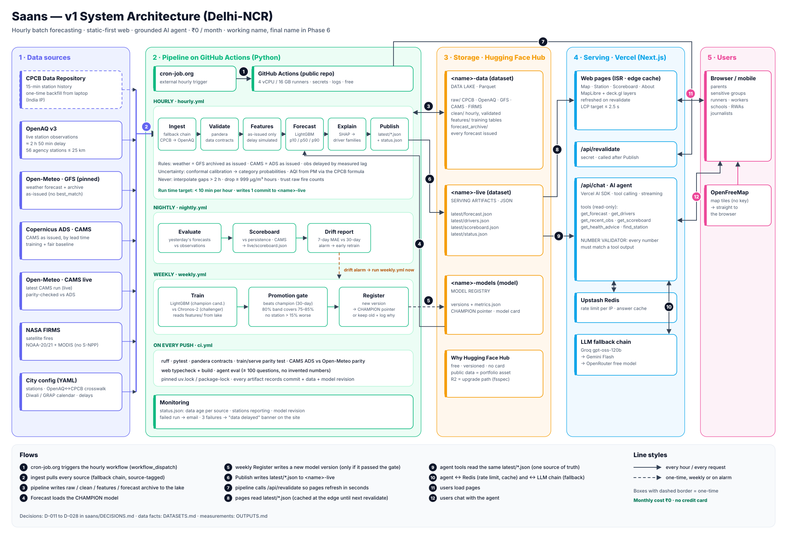

# Aagahi · आगाही

**Know tomorrow's air today.** Explainable, honest 72-hour air-quality forecasts for every official monitoring station in Delhi-NCR.

> **Status: build phase B0 (foundation).** The design, decisions and data checks are done; the live pipeline arrives in B2.
> No forecasts are published yet. See [`docs/ROADMAP.md`](docs/ROADMAP.md).

## What it does (v1 target)

| | |
|---|---|
| **Forecast** | PM2.5 and PM10 for the next 72 hours at about 56 stations, with a likely range (p10–p90), not just one number |
| **Chances** | "48% chance of Severe tomorrow", calibrated so that 48% really means 48% |
| **Why** | The main drivers of each forecast (wind, stubble fires, humidity, time of day), from SHAP |
| **What to do** | Plain-English advice for children, older people, people with asthma, and runners |
| **Proof** | A public scoreboard comparing our accuracy with "tomorrow = today", CAMS and the official forecast |
| **Ask** | An AI assistant that answers only from Aagahi's own data, with a validator that blocks invented numbers |

## Why it is different

- **No leakage.** Training uses weather and CAMS forecasts *as they were issued*, with real data delays simulated. Every reported score uses lead-exact inputs ([D-012](docs/DECISIONS.md)).
- **Measured against the official forecast.** The official system caught 5 of 14 severe episodes in 2024–25 (CEEW). Aagahi publishes its own hit rate.
- **₹0 to run.** Free tiers only: GitHub Actions, Hugging Face Hub, Vercel Hobby, Open-Meteo, OpenAQ, Copernicus, NASA FIRMS.

## Architecture



Hourly batch pipeline (Python, Polars, DuckDB, LightGBM quantile models with conformal calibration) → data and models on Hugging Face Hub → static-first Next.js site on Vercel, with a grounded AI agent. Details: [`docs/ARCHITECTURE.md`](docs/ARCHITECTURE.md).

## Repository layout

```
configs/      one YAML file per city (stations, pinned weather model, data delays)
pipeline/     Python package `aagahi`: ingest → features → models → evaluate → publish
web/          Next.js app (build phase B5)
docs/         DECISIONS, TERMS, OUTPUTS, DATASETS, ARCHITECTURE, ROADMAP
notebooks/    exploratory and smoke-test notebooks (Phase 2 data checks)
```

## Quick start (pipeline)

```bash
cd pipeline
uv sync --dev
uv run pytest
uv run aagahi check-config
uv run aagahi aqi --pm25 180 --pm10 300    # AQI 346 · Very Poor · driven by pm25
```

## Project documents

| Document | What is in it |
|---|---|
| [DECISIONS.md](docs/DECISIONS.md) | Every decision (D-001 to D-031), with the alternatives considered and why they lost |
| [TERMS.md](docs/TERMS.md) | Plain-English glossary |
| [DATASETS.md](docs/DATASETS.md) | Data sources, licences and known traps (T-1 to T-18) |
| [OUTPUTS.md](docs/OUTPUTS.md) | Measured results of every test run |
| [ARCHITECTURE.md](docs/ARCHITECTURE.md) | System zones, data flows, review checklist |
| [ROADMAP.md](docs/ROADMAP.md) | v0.1 → v1 → v2 → v3, build phases with acceptance tests |

## Data credits

Station data: CPCB / DPCC / IMD / IITM / UPPCB / HSPCB via the CPCB portal and [OpenAQ](https://openaq.org).
Weather: [Open-Meteo](https://open-meteo.com) (CC BY 4.0). Air-quality model: Copernicus Atmosphere Monitoring Service (CAMS).
Fires: NASA FIRMS. Map tiles: OpenFreeMap / OpenStreetMap contributors.

Aagahi is an independent, non-commercial project and is not an official government forecast.

## Licence

Code: MIT (see [LICENSE](LICENSE)). Data keeps the licence of its source (see [`docs/DATASETS.md`](docs/DATASETS.md)).
